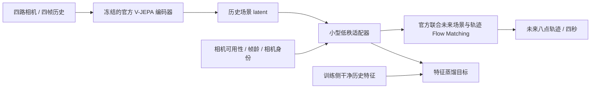

# WA-JEPA Robust

**2026 年 8 月驾驶世界动作模型 WA-JEPA 的官方权重复现与相机状态适配实验。**

这项个人研究关注一个具体问题：端到端驾驶模型收到缺失或延迟的相机历史时，
小规模、可在 8GB GPU 上训练的特征适配器，能否降低最终轨迹误差？

基于 [WA-JEPA 论文](https://arxiv.org/abs/2608.20974)（2026-08-21 首发、09-05 修订）、
[官方代码](https://github.com/AFARI-Research/WA-JEPA)和
[官方 checkpoint](https://huggingface.co/AFARI-Research/WA-JEPA)。
使用 [OpenScene](https://huggingface.co/datasets/OpenDriveLab/OpenScene) 真实驾驶数据，
并按 [NAVSIM](https://github.com/autonomousvision/navsim) 官方训练/测试 token 划分。

**当前是可运行的研究开发版本。尚未宣称复现完整预训练、完整 EPDMS 或闭环驾驶成绩。**
对比结果必须附带场景 manifest、训练划分和逐场景预测；小样本结果不代表完整 benchmark。
论文的网络结构和 checkpoint 属于原作者，新增代码与实验范围见 [NOTICE](NOTICE.md)。

**已完成的独立数据验证：** 30 个片段、4 个日志分段（3 次原始采集），
5 种输入状态与 5 种方法，共 750 次预测。组合方法的退化平均 ADE 从
1.0512m 到 1.0413m，收益约 0.94%，较小；动作适配器单独使用的平均误差
略低，连续帧龄也没有表现出明确优势。完整结果、负面发现和复现方式见
[锁定测试报告](reports/holdout_v1/README.md)。

## 技术路线



- 复现范围：严格加载官方模型，保留 256×512 输入、L0/F0/R0/B0 顺序、四步采样和固定推理种子。
- 适配模块：冻结模型，仅训练历史 token 的低秩残差；融合健康相机的池化上下文、相机身份、可用性和画面年龄。
- 干净输入：适配器走严格恒等映射，避免改进退化场景时破坏正常输入。
- 训练目标：从受损历史特征恢复干净历史特征；记录的未来图像与真实未来轨迹均不进入该训练缓存。
- 对照：官方模型、相机全黑、0.5/1 秒画面延迟、连续丢帧保持旧画面，以及无连续帧龄的适配器消融。
- 验证：轨迹 ADE/FDE、按日志进行配对 bootstrap、延迟、显存及失败案例。

特征重建变好不一定使规划变好，这也是本项目要检验的内容。
这是特征蒸馏与鲁棒适配实验，尚无全球原创性声明。

## 安装与运行

已验证环境：Windows、Python 3.12、RTX 5070 Laptop 8GB、PyTorch 2.9.1 + CUDA 12.8。
Linux 路径也使用 pathlib；尚未实机验证 Linux。训练/推理需要 CUDA GPU。

```bash
python -m venv .venv
# 激活环境后安装适合本机 GPU 的 PyTorch；Blackwell GPU 需要相应 CUDA 构建。
pip install torch==2.9.1 torchvision==0.24.1 --index-url https://download.pytorch.org/whl/cu128
pip install -e .
python -m unittest discover -s tests -v

# 约 6GB 下载，包含官方模型、训练/测试小规模相机分片和 metadata。
# 自动校验 SHA256；数据和权重不提交到 Git。
python scripts/bootstrap.py

# 先运行原模型。该命令的输出是分片子集的离线轨迹指标。
wajepa-robust evaluate --config local_test.json --output runs/baseline

# 缓存冻结编码器特征，按日志划分训练与验证，验证集决定 checkpoint。
wajepa-robust cache --config local_train.json --output cache/train
wajepa-robust train --cache cache/train --output runs/adapter_age --epochs 40
wajepa-robust train --cache cache/train --output runs/adapter_binary --epochs 40 --no-age

wajepa-robust evaluate --config local_test.json --output runs/adapted --adapter runs/adapter_age/adapter.pt
python scripts/report.py --baseline runs/baseline --candidate runs/adapted --output reports/local
```

`local_*.json` 保存本机路径，自动被 Git 忽略。可用 `--limit` 控制初次运行场景数，
但正式比较必须采用同一份完整 token manifest。训练缓存约每场景 72MB，需预留磁盘。

扩大数据覆盖范围：

```bash
python scripts/expand_data.py --mini 6 4 21 19 --test 19 25 15
# 保持相同配置目录，重新生成 cache manifest 后训练；旧缓存可复用。
# 大文件 HTTP 不稳定时，可使用经过本机验证的 HF Hub HTTP 下载后端：
pip install -e ".[download]"
python scripts/expand_data.py --test 19 25 15 --backend hf
```

上述分片按下载体积选定，未按模型测试误差挑选。训练集、验证集、测试集之间
按日志隔离，代码会拒绝适配权重与评估日志重合。数据原始授权条件见官方分发页。

## 证据与限制

第一轮真实数据结果已公开：[开发实验 1](reports/dev_v1/README.md)。
在同一批 27 个片段中，纯特征重建适配对延迟和连续丢帧有小幅改善，
但相机全黑条件变差，四种退化条件的平均 ADE 没有改善。
这轮负面结果完整保留，不能用于宣称整体性能提升。

[开发实验 2](reports/dev_v2/README.md)补充冻结世界/动作预测器的训练与
二值故障信息消融，以及无需训练的显式可靠性对照。当前没有证据证明连续
帧龄在这些小规模训练下有明显优势。针对不同故障的表现差异，新增一个
由传感器元数据选择干预方式的组合适配器，并在独立日志上验证。

后续实验增加规划目标：缓存干净模型实际四步 flow 轨迹，在冻结的联合
世界/动作预测器上反向传播，仅更新小适配器，补充动作和未来 latent 一致性。
未来 latent 来自模型预测，不使用记录的未来 RGB。

```bash
wajepa-robust cache --config local_train.json --output cache/train --with-action
python -m wajepa_robust.action_distillation --config local_train.json --cache cache/train --output runs/action_probe --probe-only
python -m wajepa_robust.action_distillation --config local_train.json --cache cache/train --output runs/adapter_action --epochs 10
python scripts/compose_adapter.py --context runs/adapter_age/adapter.pt --action runs/adapter_action/adapter.pt --output runs/hybrid/adapter.pt
wajepa-robust evaluate --config local_test.json --output runs/hybrid_eval --adapter runs/hybrid/adapter.pt
```

结果和逐场景预测将保存在 `reports/`，包含模型 revision、数据 SHA256、GPU、
采样设置、真实样本 token 和训练记录。完整实验约束见
[实验协议](docs/EXPERIMENT_PROTOCOL.md)。

目前尚未运行 NAVSIM 官方 EPDMS scorer、碰撞评估或闭环仿真。
离线轨迹误差不能替代这些评估；开发用小分片的统计置信度也有限。
推理计时包含模型 CUDA 同步、不包含读盘与图像预处理，不构成实时部署声明。

## 一个月研究目标

1. 第一周：近期论文理解、官方权重复现、真实驾驶数据、故障对照、适配模块训练。
2. 第二周：增加独立日志和训练样本；验证特征目标与动作误差是否一致，研究动作一致性蒸馏。
3. 第三周：三种子与消融、官方评分子集、速度与显存分析，冻结最终方案。
4. 第四周：最终测试、失败案例、可复现实验报告、演示与面试讲解。

当前可下载的是个人训练的约 0.4MB 小适配器，位于
[artifacts/hybrid_v0.1](artifacts/hybrid_v0.1/README.md)。
详见[四周实施与学习安排](docs/ONE_MONTH_PLAN.md)和
[面试说明与追问](docs/INTERVIEW_NOTES.md)。

这一项目与驾驶世界模型/端到端规划岗位的公开技术方向有关。
它不使用、不声称复现任何公司的未公开内部模型。
