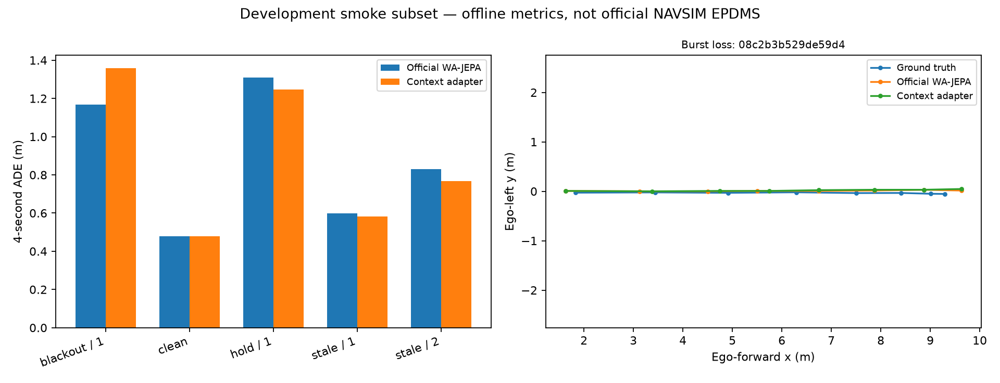

# Development experiment 1: context-only adaptation

**Outcome: mixed; no overall robustness improvement claim.**

2026-10-13, RTX 5070 Laptop 8GB, Python 3.12.10, torch 2.9.1+cu128, BF16.
Official WA-JEPA checkpoint, strict state restore, four flow steps, seed 1.
Five conditions on the identical 27 scenes from three test logs: 135 predictions
per model. These logs are a development subset, not the full benchmark.

The adapter has 52,032 parameters. It was trained on 14 clips from one navtrain
log and selected on 23 clips from another log. No test log enters adaptation.
Validation history-feature MSE fell from 0.695893 to 0.564513 (18.88%). This is
weak development evidence owing to limited independent-log diversity.

| Front-camera condition | Official ADE (m) | Context adapter ADE (m) | Direction |
|---|---:|---:|---|
| Clean | 0.477950 | 0.477950 | Exact trajectory identity |
| Full history blackout | 1.167779 | 1.358287 | Worse |
| 0.5 s stale history | 0.599846 | 0.583475 | Small decrease |
| 1.0 s stale history | 0.829519 | 0.768469 | Decrease |
| Last two frames lost, hold last valid image | 1.308216 | 1.246887 | Small decrease |

Mean across the four corrupted conditions is approximately 0.976340 m for the
official model and 0.989279 m for the adapter. **Do not report the selected
positive conditions as an overall gain.** Clean predicted trajectories match
exactly (maximum absolute coordinate difference 0).

The three-log bootstrap intervals in `paired_comparison.json` are exploratory;
such few independent logs are insufficient for generalization claims. Inference
was approximately 2 s per scene on this GPU, excluding image IO. Different
thermal/OS load across runs means this does not establish an adapter speedup.
Peak PyTorch reserved memory was 2.139 GB; total GPU usage also includes desktop
and runtime allocations.

## Diagnosis and next experiment

Lower clean-context reconstruction error did not reliably restore planning:
blackout degraded despite better feature MSE. Possible causes include very small
training diversity, feature loss emphasizing components irrelevant to planning,
and missing-view information that healthy-camera pooling cannot recover.
These are hypotheses, not established causal explanations.

The next controlled intervention supplements context reconstruction with
**frozen world/action predictor distillation**. Record the clean model's actual
four-step flow states using history only. At a sampled step, require the adapted
context to produce similar clean-teacher action endpoints and future latent
outputs. The teacher's future states are imagined latents, not recorded future
RGB. Select using held-out-log teacher action error; reserve expanded test logs
for subsequent evaluation. This keeps the local training problem small while
aligning its objective with the planning output.

## Files for verification

- `baseline_predictions.json`, `adapter_predictions.json`: every token, fault,
  predicted/target trajectory, metric, timing.
- `*_manifest.json`: exact official eligible token subset and filter SHA256.
- `*_summary.json`: hardware, precision, sampling settings and aggregated metrics.
- `training.json`: every epoch's losses and the log division.
- `assets.json`: pinned official asset URLs, sizes and SHA256 checksums.
- `paired_comparison.json`: candidate-minus-baseline paired ADE differences.

No EPDMS, collision metric, full pretraining or closed-loop result is claimed.
