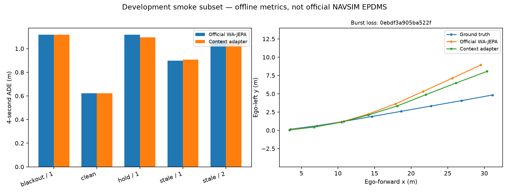

# Locked held-out experiment v0.1

**Outcome: approximately 0.94% mean corrupted ADE reduction; modest, not a
strong performance claim. Continuous-age benefit and hybrid superiority are
not established.**

On 2026-10-13, before examining predictions on this subset, freeze the routing,
weights and tokens in `frozen_protocol.json` and `locked_manifest.json`.
Use 30 scenes from OpenScene test camera shard 19, intersected with official
NAVSIM v2.2 navtest tokens. Four log **segments** come from three source drives;
two segments share a nuPlan drive and must not be treated as independent.
The three source drives are distinct from development and adaptation drives.

All five methods use the same five faults on all 30 scenes (750 predictions
total). The official checkpoint, BF16, 256×512 RGB and four-step seed-1 flow
sampler remain unchanged. Every clean prediction is exactly identical.

## Full comparison (4-second ADE, meters)

| Front-camera condition | Official | Hybrid routing | Action + age | Action + binary fault | Fixed reliability |
|---|---:|---:|---:|---:|---:|
| Clean | .621817 | .621817 | .621817 | .621817 | .621817 |
| Blackout | 1.116620 | 1.117509 | 1.117509 | 1.115392 | 1.268522 |
| Stale 0.5 s | .898775 | .907451 | .876631 | .877028 | .925872 |
| Stale 1.0 s | 1.072035 | 1.045471 | 1.052982 | 1.052330 | 1.162811 |
| Burst loss / hold | 1.117349 | 1.094968 | 1.117378 | 1.121397 | 1.094968 |
| Mean of four corrupted conditions | 1.051195 | 1.041350 | 1.041125 | 1.041537 | 1.113043 |

Hybrid reduces mean corrupted ADE by 0.009845 m (~0.94%). Its burst-loss ADE
is ~2.00% lower and 1-second stale-history ADE ~2.48% lower than official.
Blackout and 0.5-second staleness are slightly worse. The task-aligned adapter
alone has marginally lower mean ADE than hybrid, so the development-selected
routing is **not superior overall**. Binary fault metadata performs similarly
to continuous age; the proposed extra age input has no demonstrated benefit
under this small training budget. Retain this finding.

Bootstrap intervals resample **source drives**, not overlapping clips or segment
files (`all_paired_comparisons.json`). With only three independent drive clusters,
these intervals are descriptive and not reliable significance evidence.
Do not claim broad generalization, safe driving or full benchmark performance.



## Hardware and replication

RTX 5070 Laptop 8GB, Python 3.12.10, PyTorch 2.9.1+cu128; PyTorch peak reserved
inference memory 2.139 GB. Stable sequential runs measured approximately
1.18–1.20 s per prediction, excluding image IO; no real-time claim. Cached
teacher-action training peaked at approximately 4.721 GB reserved memory.

The two branch checkpoints together have 104,064 trainable parameters. Exported
personal adapter weights are available in `artifacts/hybrid_v0.1/`; only 418,440
bytes in safetensors format. Official backbone weights are external downloads.
Exported tensors were checked against the local original checkpoint exactly.

```bash
pip install -e ".[download,export]"
python scripts/bootstrap.py
python scripts/expand_data.py --test 19 --backend hf
python scripts/reproduce_locked.py --config local_test.json --output runs/locked_baseline
python scripts/reproduce_locked.py --config local_test.json --output runs/locked_hybrid --adapter artifacts/hybrid_v0.1/adapter.safetensors
```

Individual predictions, metrics and manifests for all five methods are included.
The original flow states and training caches are not redistributed, but their
generation and objectives are implemented in source. Exact training schedules
are recorded under `reports/dev_v2/`.

## What remains

This snapshot verifies recent-model reproduction and executable single-GPU
adaptation; its performance contribution is weak. A competitive next version
needs matched-data objective ablations, more source drives, multiple training
seeds, unseen fault combinations and official planning metrics. Full pretraining,
NAVSIM EPDMS scoring, collision testing and closed-loop simulation have not run.
See `docs/ONE_MONTH_PLAN.md` for the constrained next steps.

No changes were made to the frozen adapters after viewing this held-out result.
